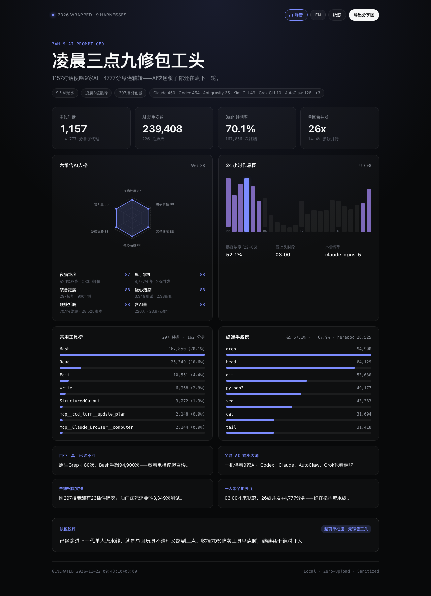
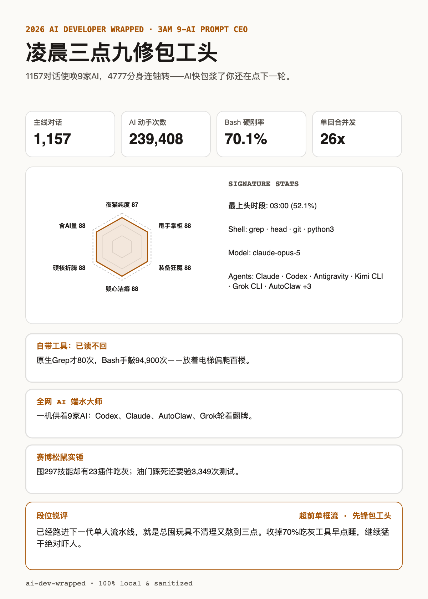

# ai-dev-wrapped

**Your AI coding year in review — across every AI assistant on your machine, authored by your own agent.**

[English](./README.md) · [简体中文](./README_CN.md)

Automatically scans **35+ local AI CLIs, IDEs, and editor extensions** (Claude Code/Desktop, Codex, Copilot CLI & VS Code Chat, Antigravity, Gemini CLI, Cursor, Windsurf, Cline, Roo Code, OpenCode, Kimi, OpenClaw/AutoClaw, Goose, Continue, Aider, Grok CLI, Trae, Qoder, Kiro, Qwen Code, and more), lets **your own agent** roast your habits with a 1-of-1 Douyin/TikTok-style persona + Tier Verdict, and opens a minimalist Linear / Apple-Notes localhost page with ambient music and 2× PNG share card export.

---

## Quick Start (2 Steps)

### 1. Install the Skill

```bash
git clone https://github.com/cuiyucheng0104-afk/ai-dev-wrapped.git ~/.claude/skills/ai-dev-wrapped

# Optional: share across Antigravity & Codex
mkdir -p ~/.gemini/antigravity/skills ~/.codex/skills
ln -s ~/.claude/skills/ai-dev-wrapped ~/.gemini/antigravity/skills/ai-dev-wrapped
ln -s ~/.claude/skills/ai-dev-wrapped ~/.codex/skills/ai-dev-wrapped
```

### 2. Trigger in Chat

Simply tell your agent:

- `"开始吧"` / `"给我年终总结"`
- `"Generate my AI developer wrapped"`

Your browser will open automatically with your personalized bilingual report.

*(Optional standalone CLI without an agent: `python3 scripts/collect.py && python3 scripts/render.py --serve --open`)*

---

## Live Showcase (Author's Real Machine Test)

Scanned on a real multi-agent workstation (**zero hardcoded templates**, **100% local & privacy-scrubbed**):

- **Detected Active Assistants (`9`)**: Claude Code / Desktop, OpenAI Codex, AutoClaw, Kimi CLI, Antigravity, GitHub Copilot, OpenClaw, Grok CLI, Cursor
- **Headline Stats**: `1,157` chats · `4,777` subagents · `239,408` tool actions · `70.1%` Bash (`94,900` bash `grep` vs `80` native `Grep`) · `26x` peak parallel · `03:00` AM peak · `297` skills installed
- **Universal 6-Axis Score Benchmark**: `70` = `0.8×` heavy baseline (`~88` on author's data); any score **`> 100` physically breaks outside the hexagon frame**!
- **Automated Verification**: `python3 -m unittest discover -s tests -v` → **9/9 OK**

### Web UI (Linear Dark) & 2× Exported Share Card

| Interactive Localhost UI | One-Click 2× Share Card PNG |
| :---: | :---: |
|  |  |

## License

[MIT](./LICENSE)
