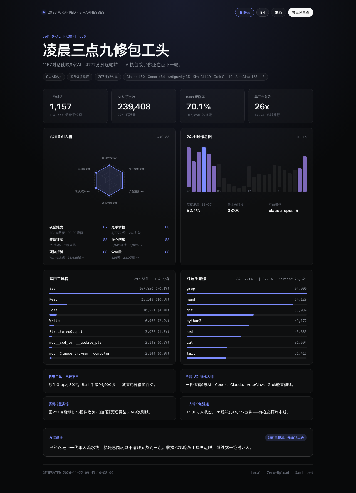
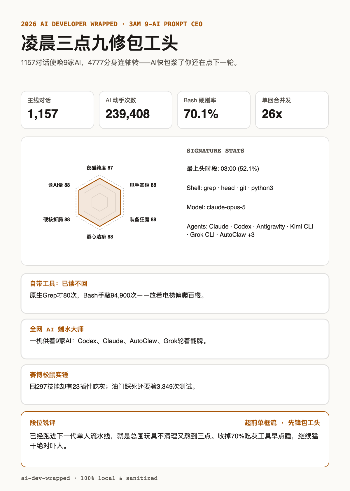

# ai-dev-wrapped

**AI 开发者的全机跨平台年终总结 Skill —— 自动扫遍电脑里 35+ AI 助手记录，交由你自己的 Agent 毒舌剖析专属人设与段位。**

[English](./README.md) · [简体中文](./README_CN.md)

零依赖、纯本地运行：自动发现并汇总电脑里的各大 AI 编程工具（Claude Code / Desktop、Codex、GitHub Copilot CLI & VS Code Chat、Antigravity、Gemini CLI、Cursor、Windsurf、Cline、Roo Code、OpenCode、Kimi、OpenClaw / AutoClaw、Goose、Continue、Aider、Grok CLI、Trae、Qoder、Kiro、Qwen Code 等），由**用户自己的 Agent** 现场写出一版不撞款的抖音/小红书风年终人设 + 90% 毒舌 / 10% 鼓励的段位锐评，并自动拉起带轻音乐与分享长图导出的极简 `localhost` 页面。

---

## 使用步骤（两步开跑）

### 1. 安装 Skill

```bash
git clone https://github.com/cuiyucheng0104-afk/ai-dev-wrapped.git ~/.claude/skills/ai-dev-wrapped

# 可选：软链共享给 Antigravity 与 Codex
mkdir -p ~/.gemini/antigravity/skills ~/.codex/skills
ln -s ~/.claude/skills/ai-dev-wrapped ~/.gemini/antigravity/skills/ai-dev-wrapped
ln -s ~/.claude/skills/ai-dev-wrapped ~/.codex/skills/ai-dev-wrapped
```

### 2. 对话一句话触发

打开任意支持的 Agent，直接输入：

- `开始吧`
- `给我年终总结`
- `Generate my AI developer wrapped`

Agent 会自动扫描本机统计、由它自己为你写出 1-of-1 双语人格与段位锐评，并自动在浏览器打开 `127.0.0.1` 页面（支持 Linear 暗夜 / Apple 备忘录纸感切换、中英切换、环境轻音乐及 2× 高清 PNG 分享图导出）。

*（可选纯命令行直出：`python3 scripts/collect.py && python3 scripts/render.py --serve --open`）*

---

## 我的真实实测展示

在同一台开发机上的实跑记录（**无预设人格桶，全脱敏本地直出**）：

- **本机自动扫出活跃助手（`9` 家）**：Claude Code / Desktop、OpenAI Codex、AutoClaw、Kimi CLI、Antigravity、GitHub Copilot、OpenClaw、Grok CLI、Cursor
- **核心战绩**：`1,157` 场对话 · `4,777` 个分身 · `239,408` 次动手调用 · `70.1%` 终端 Bash（手敲 `94,900` 次 `grep` vs 原生 `Grep` `80` 次）· 单轮最高 `26x` 并发 · 凌晨 `03:00` 巅峰 · `297` 个本地技能
- **全球统一六维标尺**：以实测数据的 `0.8×` 锚定为 **`70` 分档位**（作者本机基准约 **`88` 分**）；如果超过 **`100` 分，雷达图会直接冲出外框破表绘制**！
- **单元测试结果**：`python3 -m unittest discover -s tests -v` → **9 项测试全部通过 (`OK`)**

### 网页界面与一键导出 2× 分享图效果

| Linear 暗夜极简网页 | 一键导出的 2× 备忘录分享图 |
| :---: | :---: |
|  |  |

## 开源协议

[MIT](./LICENSE)
